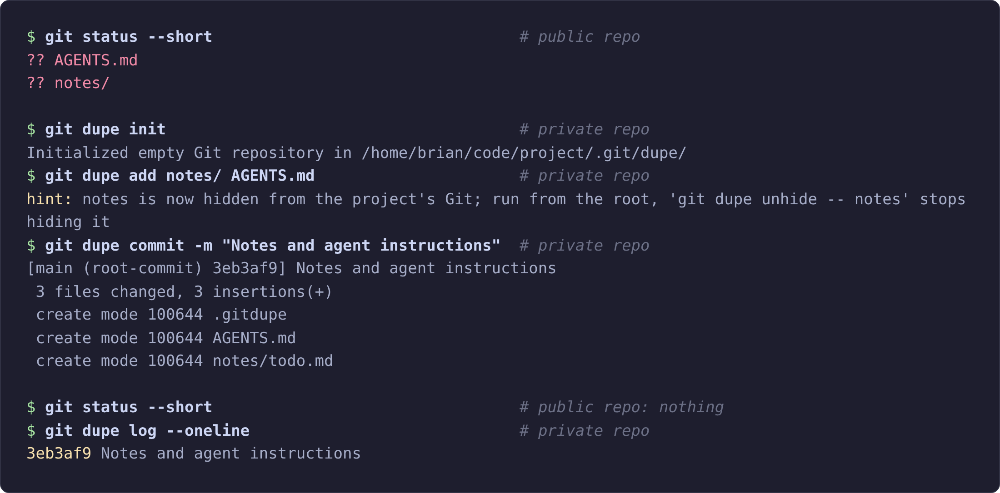

# git-dupe

[](https://github.com/BrianWeiHaoMa/git-dupe/actions/workflows/ci.yml)
[](https://github.com/BrianWeiHaoMa/git-dupe/releases/latest)
[](LICENSE)

git-dupe is a second Git repository for the files in a checkout that are yours and not
the project's: notes, plans, scratch scripts, editor settings, the instructions and
skills you keep for a coding agent. The files stay where their tools expect them in the
working tree. Their history lives in a repository of their own inside the project's
`.git`, hidden from the project's `git status` and `git add -A`, and moves between your
machines through a remote of your own. You already know how to drive it: public work is
`git …`, your own is `git dupe …`, with Git's own commands, options, output, and exit
codes.



## Install

On x86-64 Linux or macOS, with Git 2.43.0 or newer, below 3.0.0:

```sh
curl -fsSL https://raw.githubusercontent.com/BrianWeiHaoMa/git-dupe/main/install.sh | sh
```

It puts the latest release's executable in `~/.local/bin` and its manual page in
`~/.local/share/man/man1`, once the download matches its published digest.
[Installing](docs/install.md) has the rest: the archives by hand, from source, the Git
it needs, and uninstalling.

## Quick start

In a clone of a project, from the root. Here `notes/` is a directory of yours and
`AGENTS.md` your instructions for a coding agent, neither of them the project's:

```sh
git dupe init                                      # attach an empty dupe to this clone
git dupe add notes/ AGENTS.md                      # hide them from the project and stage them
git dupe commit -m "Notes and agent instructions"  # a commit git log never shows
git dupe remote add origin <url>                   # an empty repository of your own
git dupe push -u origin HEAD                       # send the history there
git dupe clone <url>                               # in a clone elsewhere: the files come back
```

`<url>` is an empty repository on a host or a disk you trust, with the project's branch
as its default branch, which `git dupe clone` checks out unless `-b` names another; on a
disk, `git init --bare -b main` makes one for a project on `main`. A URL of the
project's repository, or of any of its remotes, is refused. From then on,
`git dupe pull` and `git dupe push` move your work between machines. A file the
project's `.gitignore` ignores is added with `-f`, as `git add` adds one.

## Things to know

- **It is Git.** Every command but the few below is Git's own, with Git's options,
  output, and exit status, run against the dupe; Git's global options go before `dupe`.
- **Seven commands added:** `init` and `clone` attach the dupe and `detach` removes it,
  `hide` and `unhide` edit the list of hidden paths, `git` runs Git against the dupe
  with no guard, and `help` prints the texts.
- **Three commands changed:** `status` and `add` act on the hidden paths instead of
  every file of the project, and `clean` cleans the project while sparing them.
- **A few forms refused:** `stash -u` and `-a`, which would stash the whole project, and
  a `push`, `pull`, `fetch`, `remote`, or `clone` naming the project's repository or any
  of its remotes. `git dupe git <words>` runs them when you mean it.
- **Plain `git` is not guarded.** To the project's Git your files are ignored files:
  `git clean -x` deletes them, `git stash -a` stashes them, `git add -f` makes them
  public, and a public pull or checkout that brings a file to one of their paths
  overwrites yours. Commit first: `git dupe restore .`, from the root, brings back every
  file the dupe tracks as last staged.
- **Each worktree on its own.** A linked worktree is attached by its own `git dupe init`
  or `git dupe clone`, and `git worktree remove` and `git worktree prune` delete its
  dupe with it, whatever files of yours stand there, so push first.
- **Nothing is encrypted.** Push to a remote you would trust with the files.

More of what it does not do is under [Limits](docs/how-it-works.md#limits), and
`git dupe detach` takes it back out, leaving every file on disk.

## Read more

- [How it works](docs/how-it-works.md): the dupe, the hidden paths, what git-dupe
  writes, its limits, and the specification it is built to.
- [What it is for](docs/use-cases.md): the uses it was made for, and how it compares
  with what you may already use.
- [Questions](docs/questions.md): worktrees, teams, clones, and getting out.
- [Installing](docs/install.md): the script, the archives by hand, from source, and the
  Git it needs.
- `git dupe help`, and `git dupe help <command>` for each command git-dupe adds or
  changes: a screen each, from the executable alone.
- `man git-dupe`, where the manual page is installed: the commands, a quick start,
  examples, and explanations.
- [`PRODUCT_SPECIFICATION.md`](PRODUCT_SPECIFICATION.md): what git-dupe does and
  guarantees, and what it does not; [`TECHNICAL_SPECIFICATION.md`](TECHNICAL_SPECIFICATION.md):
  how each guarantee holds.
- [`CONTRIBUTING.md`](CONTRIBUTING.md): what governs a change, how to report a problem,
  and how to run the checks; [`CHANGELOG.md`](CHANGELOG.md): what changed in each
  release; [`RELEASING.md`](RELEASING.md): what a release holds and how one is made.

## License

MIT, in [`LICENSE`](LICENSE).
